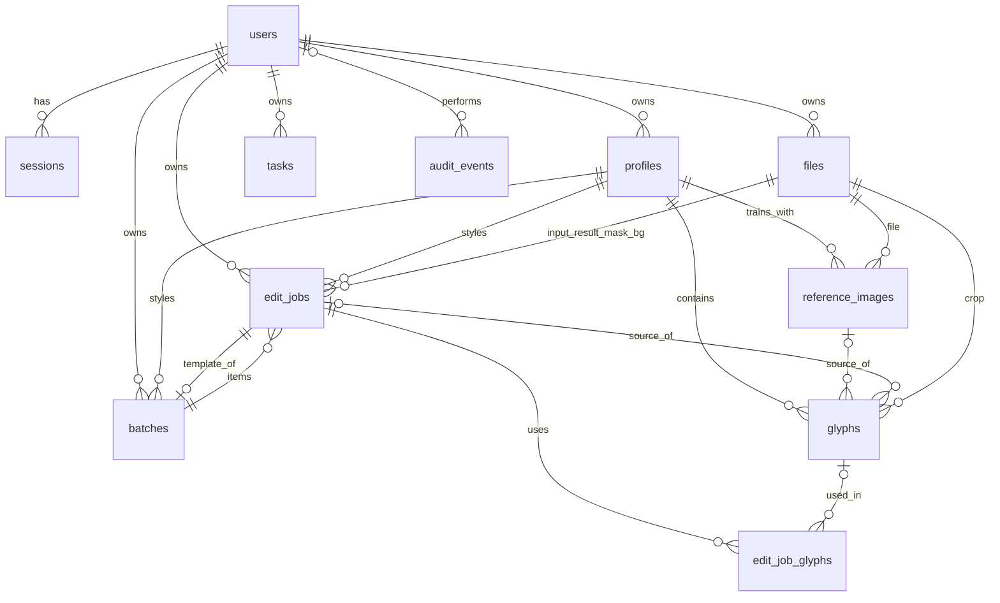

# DATABASE — Traid

**Owner:** Xavier Sun
**Status:** Draft v1.0
**Derives from:** PRD.md, ARCHITECTURE.md

---

## 1. Technology

| Item | Choice |
|------|--------|
| Engine | **SQLite 3** (bundled with Python), single file `data/traid.db` |
| Mode | WAL journal, `foreign_keys=ON`, `busy_timeout=5000`, `synchronous=NORMAL` |
| Access | SQLAlchemy 2.x ORM (typed models) — no raw SQL strings in application code |
| Migrations | Alembic (`backend/app/migrations`) |
| Binary data | Never in the DB. Image files live in `data/files/` (content-addressed); the DB stores references (`files` table). |

Why SQLite: one local user, one process, one worker thread. It is transactional, zero-maintenance, trivially backed up, and the schema is portable to PostgreSQL later (§11).

## 2. Conventions

| Convention | Rule |
|-----------|------|
| Primary keys | `id TEXT` — UUIDv4 string (36 chars), generated by the application |
| Timestamps | `TIMESTAMP` stored as ISO-8601 UTC text (`2026-10-20T14:03:11.123Z`); `created_at` on every table, `updated_at` where rows change |
| Booleans | `INTEGER` 0/1 with `CHECK (col IN (0,1))` |
| Enums | `TEXT` + `CHECK (col IN (...))` |
| JSON | `TEXT` containing JSON, validated by Pydantic before write; `CHECK (json_valid(col))` |
| Naming | `snake_case`, plural table names, FK columns `<entity>_id` |
| Deletes | Hard delete with `ON DELETE` rules below, except profiles (archive first via `archived_at`) and audit events (never deleted) |
| Ownership | Every user-owned root entity has `owner_id`; child rows inherit ownership through their parent |

---

## 3. Tables

### 3.1 `users`
| Column | Type | Null | Default | Notes |
|--------|------|------|---------|-------|
| id | TEXT | no | — | PK |
| username | TEXT | no | — | UNIQUE (case-insensitive: stored lower-case), 3–32 chars `^[a-z0-9_.-]+$` |
| display_name | TEXT | no | — | 1–60 chars |
| password_hash | TEXT | yes | — | Argon2id encoded string. NULL in local mode (no sign-in, PRD D-03); migration `0003_local_owner` makes it nullable |
| role | TEXT | no | `'owner'` | CHECK in (`owner`, `editor`) — only `owner` used in MVP |
| is_active | INTEGER | no | 1 | |
| failed_login_count | INTEGER | no | 0 | CHECK ≥ 0 |
| locked_until | TIMESTAMP | yes | — | Lockout end |
| aup_accepted_at | TIMESTAMP | yes | — | Acceptable-use acknowledgement (PRD §10) |
| last_login_at | TIMESTAMP | yes | — | |
| created_at / updated_at | TIMESTAMP | no | now | |

### 3.2 `sessions`
| Column | Type | Null | Notes |
|--------|------|------|-------|
| id | TEXT | no | PK |
| user_id | TEXT | no | FK → users.id ON DELETE CASCADE |
| token_hash | TEXT | no | UNIQUE; SHA-256 hex of the cookie token (raw token never stored) |
| csrf_secret | TEXT | no | Random 32-byte hex; returned to the client via `/auth/me` |
| created_at | TIMESTAMP | no | |
| last_seen_at | TIMESTAMP | no | Sliding idle expiry (updated at most once per minute) |
| expires_at | TIMESTAMP | no | Absolute expiry |
| revoked_at | TIMESTAMP | yes | Set on logout / password change |
| user_agent | TEXT | yes | Truncated to 200 chars |

### 3.3 `files`
Central registry of every stored binary (inputs, glyph crops, masks, results, exports, backups).

| Column | Type | Null | Notes |
|--------|------|------|-------|
| id | TEXT | no | PK |
| owner_id | TEXT | no | FK → users.id ON DELETE RESTRICT |
| sha256 | TEXT | no | Content hash (64 hex) |
| kind | TEXT | no | CHECK in (`reference`, `target`, `glyph`, `mask`, `background`, `result`, `export`, `batch_zip`, `backup`, `thumbnail`) |
| mime_type | TEXT | no | CHECK in (`image/jpeg`, `image/png`, `image/tiff`, `application/zip`) |
| byte_size | INTEGER | no | CHECK > 0 |
| width / height | INTEGER | yes | Pixels (images only), CHECK > 0 |
| dpi_x / dpi_y | REAL | yes | Preserved for export |
| has_icc | INTEGER | no | 0/1 |
| jpeg_quality_est | INTEGER | yes | 1–100, estimated from quantization tables |
| storage_path | TEXT | no | Relative path inside `data/files`, derived from sha256 (`ab/cd/<sha256>.<ext>`) |
| original_name | TEXT | yes | Sanitized display name, ≤ 255 chars |
| created_at | TIMESTAMP | no | |

Constraints: UNIQUE (`owner_id`, `sha256`, `kind`) — dedupe per kind.

### 3.4 `profiles`
| Column | Type | Null | Default | Notes |
|--------|------|------|---------|-------|
| id | TEXT | no | — | PK |
| owner_id | TEXT | no | — | FK → users.id ON DELETE RESTRICT |
| name | TEXT | no | — | 1–60 chars; UNIQUE (`owner_id`, `name`) |
| description | TEXT | yes | — | ≤ 500 chars |
| surface_type | TEXT | no | `'print'` | CHECK in (`print`, `paint`, `laser_mark`, `engraved`); selects ink vs relief blending (PRD FR-E15) |
| charset | TEXT | no | `'0123456789ABCDEFGHIJKLMNOPQRSTUVWXYZ-/# '` | 1–96 unique printable chars. UI presets (digits / uppercase + digits / full Latin) only fill this field; no separate preset column |
| token_pattern | TEXT | yes | — | Regex, ≤ 200 chars, compiled & validated on write |
| pattern_strict | INTEGER | no | 0 | 1 = mismatching tokens are rejected |
| alignment | TEXT | no | `'auto'` | CHECK in (`auto`, `left`, `center`, `right`) |
| spacing_mode | TEXT | no | `'auto'` | CHECK in (`auto`, `monospace`, `proportional`) |
| ready_threshold | INTEGER | no | 3 | CHECK 1–20 confirmed glyphs per char |
| use_auto_glyphs | INTEGER | no | 0 | 1 = allow high-confidence unreviewed glyphs in renders |
| engine | TEXT | no | `'glyph_transplant'` | CHECK in (`glyph_transplant`) — Phase 2 adds `generative` |
| learned_params | TEXT (JSON) | no | `'{}'` | EMA (alpha 0.2) of accepted adjustments in render-param keys, only values that differ from the default, e.g. `{"dx":1.95,"ink_tone":0.24}`; new jobs start from it |
| typical_region | TEXT (JSON) | yes | — | Welford running stats of accepted token quads, normalised to image size: `{"count":37,"cx":0.62,"cy":0.18,"sx":0.03,"sy":0.01,"w":0.21,"h":0.04,"m2_cx":…}` |
| metrics | TEXT (JSON) | yes | — | Layout stats learned from references: pitch, cap-height ratio, advances per char |
| archived_at | TIMESTAMP | yes | — | Archived profiles hidden by default |
| created_at / updated_at | TIMESTAMP | no | now | |

`status` is **not stored**; it is derived (avoid duplication): `training` if any extraction task is queued/running, `ready` if coverage rule met, `needs_review` if auto glyphs await review and rule not met, else `draft`.

### 3.5 `reference_images`
| Column | Type | Null | Notes |
|--------|------|------|-------|
| id | TEXT | no | PK |
| profile_id | TEXT | no | FK → profiles.id ON DELETE CASCADE |
| file_id | TEXT | no | FK → files.id ON DELETE RESTRICT |
| known_text | TEXT | yes | Owner-provided token text, ≤ 64 chars |
| status | TEXT | no | CHECK in (`pending`, `processing`, `processed`, `failed`) |
| error_code | TEXT | yes | e.g. `NO_TEXT_FOUND` |
| conditions | TEXT (JSON) | yes | Estimated brightness, contrast, blur σ, noise σ, angle |
| created_at / updated_at | TIMESTAMP | no | |

Constraints: UNIQUE (`profile_id`, `file_id`) — same image cannot be added twice to a profile.

### 3.6 `glyphs`
| Column | Type | Null | Default | Notes |
|--------|------|------|---------|-------|
| id | TEXT | no | — | PK |
| profile_id | TEXT | no | — | FK → profiles.id ON DELETE CASCADE |
| source_reference_id | TEXT | yes | — | FK → reference_images.id ON DELETE CASCADE |
| source_job_id | TEXT | yes | — | FK → edit_jobs.id ON DELETE SET NULL (glyph harvested from a target's *original* pixels). Added by migration `0005_edit_jobs` (filled from Phase 11) |
| crop_file_id | TEXT | no | — | FK → files.id (RGBA PNG: ink texture + soft alpha) |
| char | TEXT | no | — | Exactly 1 character, must be in profile charset (service-validated) |
| status | TEXT | no | `'auto'` | CHECK in (`auto`, `confirmed`, `rejected`) |
| source_quad | TEXT (JSON) | no | — | 4 points in source image pixels |
| cap_height_px | REAL | no | — | CHECK > 0 |
| stroke_width_px | REAL | no | — | CHECK > 0 |
| blur_sigma | REAL | no | — | CHECK ≥ 0 |
| noise_sigma | REAL | no | — | CHECK ≥ 0 |
| ink_color | TEXT | no | — | `#RRGGBB` |
| bg_luma | REAL | no | — | 0–1 |
| contrast | REAL | no | — | 0–1 |
| angle_deg | REAL | no | — | −90…90 |
| light_dir_deg | REAL | yes | — | 0…360, dominant lighting direction on the stroke rim; set for relief profiles (`laser_mark`, `engraved`), NULL otherwise |
| ocr_confidence | REAL | no | — | 0–1 |
| quality_score | REAL | no | — | 0–1 (sharpness, completeness, isolation) |
| baseline_y | REAL | yes | — | Text baseline inside the crop (px from its top), measured at extraction; places the glyph vertically. Added by `0005_edit_jobs`; NULL for older glyphs (layout falls back to the ink box) |
| use_count | INTEGER | no | 0 | CHECK ≥ 0 |
| accept_count | INTEGER | no | 0 | CHECK ≥ 0 |
| reject_count | INTEGER | no | 0 | CHECK ≥ 0 |
| created_at / updated_at | TIMESTAMP | no | now | |

Constraints: `CHECK ((source_reference_id IS NOT NULL) + (source_job_id IS NOT NULL) <= 1)`; `CHECK (length(char) = 1)`.

Note: when a source job is deleted the glyph is kept (it is real data the owner confirmed) — hence `SET NULL`.

### 3.7 `batches`
| Column | Type | Null | Notes |
|--------|------|------|-------|
| id | TEXT | no | PK |
| owner_id | TEXT | no | FK → users.id ON DELETE RESTRICT |
| profile_id | TEXT | no | FK → profiles.id ON DELETE RESTRICT |
| template_job_id | TEXT | no | FK → edit_jobs.id ON DELETE RESTRICT |
| name | TEXT | yes | ≤ 80 chars |
| status | TEXT | no | CHECK in (`queued`, `running`, `completed`, `cancelled`, `failed`) |
| total_count | INTEGER | no | CHECK 1–1000 |
| export_file_id | TEXT | yes | FK → files.id ON DELETE SET NULL (latest ZIP) |
| client_request_id | TEXT | yes | Idempotency key from client; UNIQUE (`owner_id`, `client_request_id`) |
| created_at / updated_at | TIMESTAMP | no | |
| finished_at | TIMESTAMP | yes | |

Counts by status are derived from `edit_jobs` (not stored).

### 3.8 `edit_jobs`
| Column | Type | Null | Notes |
|--------|------|------|-------|
| id | TEXT | no | PK |
| owner_id | TEXT | no | FK → users.id ON DELETE RESTRICT |
| profile_id | TEXT | no | FK → profiles.id ON DELETE RESTRICT |
| batch_id | TEXT | yes | FK → batches.id ON DELETE CASCADE |
| input_file_id | TEXT | no | FK → files.id ON DELETE RESTRICT |
| status | TEXT | no | CHECK in (`uploaded`, `detecting`, `detected`, `rendering`, `rendered`, `accepted`, `rejected`, `failed`) |
| regions | TEXT (JSON) | yes | `[{"id":"r1","quad":[[x,y]×4],"text":"A7-204913","confidence":0.97,"score":0.91,"reasons":["pattern","position"]}]` |
| selected_region_id | TEXT | yes | `regions[].id` the quad came from; NULL for a drawn quad |
| selected_quad | TEXT (JSON) | yes | Final quad (possibly owner-adjusted) |
| original_text | TEXT | yes | Old token, ≤ 64 chars |
| new_text | TEXT | yes | New token, ≤ 64 chars |
| params | TEXT (JSON) | no | Render adjustments (`{"dx":0,"dy":0,"scale":1,"spacing":0,"weight":0,"blur":0,"ink_tone":0,"grain":1,"glyph_overrides":{}}`) |
| geometry | TEXT (JSON) | yes | `{"render": {layout_mode, glyphs_used, warnings, timings_ms}}` of the current render |
| background_file_id | TEXT | yes | FK → files.id ON DELETE SET NULL. Reserved: the inpainted background is cached in the worker process for now (ARCHITECTURE §3.3) |
| mask_file_id | TEXT | yes | FK → files.id ON DELETE SET NULL |
| result_file_id | TEXT | yes | FK → files.id ON DELETE SET NULL |
| quality | TEXT (JSON) | yes | QualityReport: `{"ocr_readback":"A7-204914","ocr_match":true,"seam":0.04,"noise_ratio":1.02,…,"overall":"pass"}` |
| quality_overall | TEXT | yes | CHECK in (`pass`, `warn`, `fail`) — denormalized from `quality` for filtering (justified: indexed list filter) |
| engine_version | TEXT | yes | e.g. `glyph_transplant@1.0.0` |
| seed | INTEGER | no | Random seed for determinism |
| reject_reason | TEXT | yes | ≤ 300 chars |
| error_code | TEXT | yes | |
| accepted_at / exported_at | TIMESTAMP | yes | |
| created_at / updated_at | TIMESTAMP | no | |

State machine (enforced in `services/jobs.py`):
```
uploaded → detecting → detected → rendering → rendered → accepted
                ↘ failed         ↗   ↘ failed     ↘ rejected → rendering (retry)
detected/rendered → (region changed) → detected
accepted → (re-open as new job; accepted jobs are immutable)
```

### 3.9 `edit_job_glyphs`
Which glyph was used at each character position of the job's current render (for learning).

| Column | Type | Null | Notes |
|--------|------|------|-------|
| job_id | TEXT | no | FK → edit_jobs.id ON DELETE CASCADE |
| position | INTEGER | no | 0-based index in `new_text` |
| glyph_id | TEXT | yes | FK → glyphs.id ON DELETE SET NULL; NULL when the glyph came from the same image (not yet in bank) |
| source | TEXT | no | CHECK in (`same_image`, `bank`) |

PK (`job_id`, `position`). Rows are replaced on every render.

### 3.10 `tasks`
| Column | Type | Null | Notes |
|--------|------|------|-------|
| id | TEXT | no | PK |
| owner_id | TEXT | no | FK → users.id ON DELETE CASCADE |
| type | TEXT | no | CHECK in (`extract_glyphs`, `detect`, `render`, `batch_run`, `batch_export`, `backup`) |
| subject_type | TEXT | no | CHECK in (`profile`, `reference_image`, `edit_job`, `batch`, `system`) |
| subject_id | TEXT | yes | ID of subject (polymorphic, no FK) |
| payload | TEXT (JSON) | no | Handler input (no secrets) |
| status | TEXT | no | CHECK in (`queued`, `running`, `succeeded`, `failed`, `cancelled`) |
| progress | REAL | no | 0–1 |
| message | TEXT | yes | Current stage label |
| cancel_requested | INTEGER | no | 0/1 |
| error_code | TEXT | yes | |
| created_at | TIMESTAMP | no | |
| started_at / finished_at | TIMESTAMP | yes | |

### 3.11 `audit_events` (append-only)
| Column | Type | Null | Notes |
|--------|------|------|-------|
| id | TEXT | no | PK |
| user_id | TEXT | yes | FK → users.id ON DELETE SET NULL (NULL for failed logins of unknown users) |
| action | TEXT | no | Closed list, e.g. `system.aup_accepted`, `auth.setup`, `auth.login`, `auth.login_failed`, `auth.logout`, `auth.password_changed`, `profile.created`, `profile.archived`, `profile.deleted`, `job.accepted`, `job.rejected`, `job.exported`, `job.deleted`, `batch.exported`, `settings.updated`, `backup.created` |
| subject_type | TEXT | yes | |
| subject_id | TEXT | yes | |
| details | TEXT (JSON) | no | Non-sensitive context (IDs, counts, format). Never passwords, tokens, CSRF secrets. |
| created_at | TIMESTAMP | no | |

Triggers: `BEFORE UPDATE` and `BEFORE DELETE` on `audit_events` → `RAISE(ABORT, 'audit_events is append-only')`. The one permitted update is the foreign-key action `ON DELETE SET NULL` clearing `user_id` when a user is deleted (every other column must be unchanged); otherwise the FK rule and the trigger would contradict each other.

### 3.12 `app_settings`
| Column | Type | Null | Notes |
|--------|------|------|-------|
| key | TEXT | no | PK; closed list: `export.default_format`, `export.filename_pattern`, `export.metadata_marker`, `export.jpeg_quality_mode`, `storage.backup_retention`, `export.default_author`, `export.default_copyright` |
| value | TEXT (JSON) | no | Validated per key |
| updated_by | TEXT | yes | FK → users.id ON DELETE SET NULL |
| updated_at | TIMESTAMP | no | |

---

## 4. Relationships & ER diagram



---

## 5. Constraints & validation summary

| Rule | Where enforced |
|------|---------------|
| Unique username, unique profile name per owner, unique file per (owner, sha256, kind), unique reference per profile | DB UNIQUE |
| Enum values, numeric ranges, JSON validity, single-char glyph | DB CHECK + Pydantic |
| Glyph char ∈ profile charset | Service (charset can change; on charset change, glyphs with removed chars are kept but ignored) |
| new_text chars ∈ charset; pattern match when strict; length 1–64 | Pydantic + service |
| Token pattern is a valid regex, ≤ 200 chars, compiled with timeout guard (no catastrophic patterns — reject nested quantifiers) | Service |
| Job state transitions | Service state machine |
| Accepted jobs immutable | Service (no update path) |
| Audit append-only | DB triggers |
| Batch size 1–1000 | DB CHECK + Pydantic |

---

## 6. Indexes (from real queries)

| Index | Query it serves |
|-------|-----------------|
| `sessions(token_hash)` UNIQUE | Resolve session on every request |
| `sessions(user_id, revoked_at)` | Revoke all sessions on password change |
| `files(owner_id, sha256, kind)` UNIQUE | Upload dedupe |
| `profiles(owner_id, archived_at, updated_at DESC)` | Profiles list (non-archived, recent first) |
| `reference_images(profile_id, created_at)` | References tab |
| `reference_images(profile_id, status)` | Derived profile status / pending count |
| `glyphs(profile_id, char, status, quality_score DESC)` | Glyph grid by character; glyph selection candidates; coverage counts |
| `glyphs(source_reference_id)` | Delete/re-extract a reference |
| `edit_jobs(owner_id, batch_id, created_at DESC, id)` | History list (batch_id IS NULL for singles) + cursor pagination; Home recent jobs |
| `edit_jobs(owner_id, profile_id, status, created_at DESC)` | History filters; profile acceptance stats |
| `edit_jobs(batch_id, quality_overall, status)` | Batch review (warnings first) and counts |
| `edit_jobs(owner_id, new_text)` and `edit_jobs(owner_id, original_text)` | History search by token (prefix `LIKE 'abc%'`) |
| `edit_job_glyphs(glyph_id)` | Glyph usage lookups / learning |
| `tasks(status, created_at)` | Worker claims oldest queued |
| `tasks(subject_type, subject_id, status)` | "Is profile training?" / job's active task |
| `audit_events(created_at DESC)` | Audit log view |
| `batches(owner_id, created_at DESC)` | Batch list |

No other indexes until a measured need appears.

---

## 7. Ownership, authorization & row-level security

- **Ownership roots:** `profiles`, `files`, `edit_jobs`, `batches`, `tasks` carry `owner_id`. `reference_images`, `glyphs`, `edit_job_glyphs` inherit via their parent.
- **Enforcement:** SQLite has no row-level security. Ownership is enforced in the repository layer: every query on an owned table includes `owner_id = :current_user_id` (or joins to an owned parent). Repositories expose no un-scoped read methods to services. Integration tests assert that a second (test-only) user receives `404` for every resource of the first.
- **Roles:** `role` column on `users`; permission checks happen in API dependencies (`require_role`) per PRD §12.
- **Future PostgreSQL RLS** (when multi-user is approved): enable RLS on owned tables with policy `owner_id = current_setting('app.user_id')::uuid`, set per transaction by the app; child tables use `EXISTS` policies against the parent.

## 8. Sensitive data handling

| Data | Sensitivity | Handling |
|------|------------|----------|
| Password | Secret | Only Argon2id hash stored; never logged or returned |
| Session token | Secret | Only SHA-256 stored; cookie HttpOnly |
| CSRF secret | Secret | Stored per session, returned only to authenticated owner, never logged |
| Token values (`original_text`, `new_text`, `known_text`) | Confidential business data | Stored (needed for history/search); excluded from logs; included in audit only by job ID reference |
| Images & glyph crops | Confidential | Local disk only; served only to the authenticated owner; deleted with their owning rows (orphan sweep) |
| Audit details | Internal | IDs, counts, formats only |

File cleanup (implemented in Phase 13, `services/maintenance.py`): a sweep on startup deletes `files` rows of derived kinds (`mask`, `result`, `background`, `glyph`) older than one hour that no table references, and their disk file when no other row shares it. Uploads, exports, ZIPs and backups are never swept (exports are deliberately unreferenced records of what was handed out).

## 9. Migration strategy

- Alembic with one revision per change, descriptive names (`0001_initial_auth`, `0002_profiles_glyphs`, …) aligned with IMPLEMENTATION_PLAN phases.
- Revisions are forward-only in production; each still defines `downgrade()` for development.
- On app start (every environment except tests): if the existing database is behind the newest migration, create `data/backups/pre-migrate-<rev>-<timestamp>.zip` → `alembic upgrade head` → start. A fresh install or an up-to-date database is not backed up. If the migration fails, the app refuses to start; the backup is next to the database.
- Schema changes that rewrite tables (SQLite limitations) use Alembic batch mode.
- No destructive migration (dropping columns/tables with data) without an explicit note in the revision and owner approval.

## 10. Seed strategy

- **Production:** no seed data. The owner account is created by first-run setup; no default credentials exist. `app_settings` defaults are code constants and written lazily on first change.
- **Development/test:** `backend/tests/fixtures/generate.py` creates synthetic token images (open-licensed font, random perspective/lighting/blur/noise/JPEG). `scripts/seed_dev.py` (refuses to run when `TRAID_ENV=production`) creates a dev user with a password read from `TRAID_DEV_PASSWORD` env var, one fixture profile with extracted glyphs, and two sample jobs.

## 11. Backup & recovery

- **Backup:** `POST /system/backups` (task) or `scripts/backup.ps1`: uses SQLite online backup API to a temp DB copy (consistent while running), then zips it with `data/files/` into `data/backups/traid-YYYYMMDD-HHMMSS.zip` + a `manifest.json` (app version, schema revision, file count, sha256 of DB copy).
- **Retention:** keep last 10 manual backups + last 3 pre-migration backups (setting `storage.backup_retention`).
- **Recovery:** stop Traid → move current `data/` aside → unzip backup into `data/` → start (migrations bring older schemas up to date). Documented in README with a verification step (`/system/status` shows counts).
- **Verification:** each backup task re-opens the zipped DB and runs `PRAGMA integrity_check`; result stored on the task.
- **Recommendation to owner:** copy backups to an external drive or encrypted cloud folder manually; Traid never uploads them.

## 12. Portability (future)
Types and constraints are chosen to map 1:1 to PostgreSQL (`TEXT`→`uuid`/`text`, JSON text→`jsonb`, ISO text→`timestamptz`). No SQLite-only features beyond triggers and `json_valid`, which have PostgreSQL equivalents.
